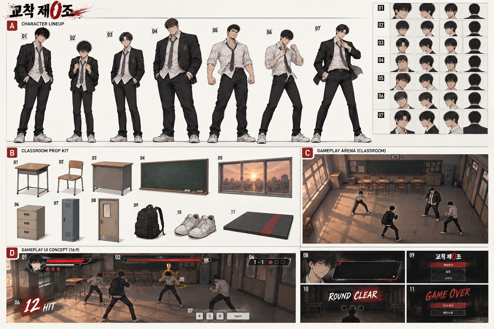
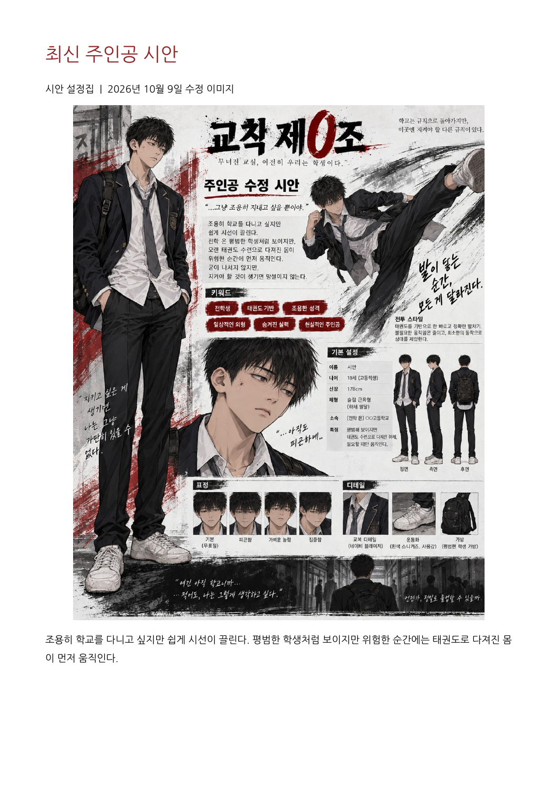

# 교칙 제0조 — Blender 에셋·UI 제작 가이드

2026-10-11 / 대상: 튜토리얼 + 1학년 1-1~1-11 / 기준 소스: f554d7f

## 1. 기준과 읽는 방법

검토 자료: 첨부 「교칙제0조_시안서_WASD.pdf」의 최신 주인공 시안, 사용자 확정 튜토리얼·보스·라운드 요청, 현재 실제 소스 PrototypeBootstrap / PrototypeCharacterView / TutorialDirector / PrototypeHUD / EnemyHealthBar / CombatEffects / CombatActor / SchoolCampaign / EncounterDirector.

‘구현’은 소스에 기능 또는 임시 형태가 있다는 뜻이다. 최종 모델이나 실제 Unity/WebGL 실행이 검증됐다는 뜻은 아니다. ‘추가 제안’은 현재 코드에 없으며 제작 후 별도 연결이 필요하다. 이 문서는 게임 기능을 변경하지 않는다. 옛 로드맵보다 현재 SchoolCampaign 규칙을 우선했다.

이름 차이: 시안서 주인공은 시안(18세·178cm), 현재 코드/HUD는 권민준. 외형은 PDF 최신 주인공을 기준으로 하고, 최종 이름은 사용자 결정 전까지 두 이름을 병기한다. 명치만/설명해/덩치/도재학/한승빈/황빈의 이름과 역할은 확정됐지만 얼굴·머리·옷의 세부는 참고용 제안이다. 참고 이미지의 안경·손목 천·교표도 확정 사항이 아니다.

## 2. 참고 이미지 읽기

A 인물: 01 주인공 / 02 명치만 / 03 설명해 / 04 덩치 / 05 도재학 / 06 한승빈 / 07 황빈. 오른쪽 작은 얼굴 이미지는 표정·헤어 분위기 참고이며 정확한 정투영 3면도가 아니다. 일반 학생 A/B와 강화형은 별도 표의 공통 몸체 변형으로 만든다.

B 소품: 01 학생 책상 / 02 의자 / 03 교탁 / 04 칠판 / 05 창문 / 06 서랍장 / 07 사물함 / 08 문 / 09 가방 / 10 운동화 / 11 매트. C는 완성 목표 교실 분위기, D는 UI 제안. 현재 게임 화면을 촬영한 이미지가 아니다. 그림의 추가 시계·의자·메뉴 버튼 등은 구현 상태와 별도로 표에 표시했다.

원본 시안의 검은 교복·흰 셔츠·회색 넥타이·검정 가방·흰 운동화와 조용한 태권도 주인공을 우선한다. 참고 그림의 화려한 붓 테두리를 모델 표면 전체에 넣기보다 UI와 충격 효과에 사용한다.

## 3. 제작 범위와 재사용

현재 11개 스테이지·22개 실전 라운드·총 적 94명이다. 동시에 등장하는 적은 매우쉬움 3명, 보통 4명까지이고 보스는 1:1이다. 94개의 고유 캐릭터 모델을 만들 필요는 없다. 플레이어 1 + 튜토리얼 상대 3 + 보스 3 = 주요 인물 7명에 일반 A/B/강화형 3변형을 추가하는 계획을 추천한다. 이것은 제작 제안이며 확정 제작 수량이 아니다.

리그는 가능한 한 공통 Humanoid 한 규격으로 공유하고, 플레이어 슬림·학생 표준·덩치 체형의 3가지 몸체 파생을 권장한다. 같은 뼈대에 체형만 바꾸면 어깨·손목·무릎 변형을 다시 검사해야 한다. HP가 달라도 별도 모델이 필요한 것은 아니다.

현재 교실은 바닥 28×18 unit, 뒤벽·낮은 측벽·앞 경계, 책상8개(2줄×4), 창문3, 서랍장1, 칠판1이다. 2번째 일반 라운드는 사물함8개를 추가하고 책상을 숨긴다. 보스 라운드는 책상을 숨기고 매트와 라인을 추가한다. 별도 복도·체육관·옥상·운동장·전 학년 배경은 구현되지 않았으며 이번 필수 범위에 넣지 않는다.

## 4. 우선순위

P0: 우선 플레이 가능한 화면 교체 — 주인공/튜토리얼3명/공통 리그·기본 모션 → 교실 바닥/벽/책상/칠판/창문/서랍 → 핵심 HUD/대사/예고/타격·회피 효과. 의자와 문은 게임 읽기와 교실 완성도를 위한 우선 추가 제안이다.

P1: 1-11 캠페인 완성 — 일반 A/B/강화형·보스3명·궁극기/잡기/반격 모션·사물함/매트·라운드/사망/완료 UI·노을 배경.

P2: 분위기와 메뉴 확장 — 시계/게시판/분필/문구류/청소도구·먼지·타이틀/설정 메뉴. 작은 소품부터 만들지 말고 실제 카메라에서 크게 보이는 것을 먼저 만든다.

## 캐릭터 전체 목록

| ID | 항목 | 상태 | 우선 | 수량 | 제작 방향 | 연결·주의 |
|---|---|---|---|---|---|---|
|CH01|주인공 시안 / 코드 권민준|시안서+구현|P0|1|슬림 178cm·검은 교복·흰 셔츠·회색 넥타이·검정 가방·흰 운동화. 기본/피곤/놀람/집중 표정|태권도 플레이어 리그. 이름은 확정 필요|
|CH02|명치만|구현·외형 제안|P0|1 변형|약한 학생·작은 실루엣·흐트러진 머리. 이미지의 안경은 선택 제안|HP12·오프닝 한 타 제압. 접근/대사/책상 차기/피격/쓰러짐|
|CH03|설명해|구현·외형 제안|P0|1 변형|보통 체형·정돈된 가르마·단정한 교복|HP36·이동/점프/앉기 안내 상대. 대사 표정|
|CH04|덩치|구현·외형 제안|P0|1 체형 변형|넓은 어깨·굵은 팔·큰 몸통. 키보다 폭으로 구분|HP72·전투 연습 상대. 현재 코드는 몸 크기까지 구분하지 않음|
|CH05|일반 학생 A / B|구현·외형 제안|P1|2 외형 변형|보통/마른 체형·머리와 교복 착용 변형. HP별로 모델을 따로 만들지 않음|HP24/48 또는36/60·공통 적 리그. 일반 적 궁극기 금지|
|CH06|강화 일반 학생|구현·외형 제안|P1|1 외형 변형|일반 학생보다 굵은 체형·넥타이/소매 차이. 보스로 오인할 왕관 등 제외|1-6~1-9 마지막 적 HP84·궁극기 없음|
|CH07|도재학 / NO.3|구현·외형 제안|P1|1|단단한 체형·짧은 머리·느슨한 넥타이. 상세 복장은 제안|1-5 보스 HP240·전 기능 공통 모션+주먹작렬|
|CH08|한승빈 / NO.2|구현·외형 제안|P1|1|날렵한 복서 체형·상체 가드 실루엣. 흰 셔츠/손목 천은 제안|1-10 보스 HP300·잽/스트레이트/K.O 펀치|
|CH09|황빈 / NO.1|구현·외형 제안|P1|1|빠른 스텝의 운동 체형·정돈된 헤어·열린 블레이저는 제안|1-11 보스 HP360·잽/스트레이트/잡기 반격/빠른 스텝. 궁극기 이름 별도 확정|

## 배경·소품 전체 목록

| ID | 항목 | 상태 | 우선 | 수량 | 제작 방향 | 연결·주의 |
|---|---|---|---|---|---|---|
|EN01|교실 바닥 모듈|구현|P0|1 모듈|타일/마루 중 선택. 큰 바닥에 반복 UV 사용|현재 28×18 Unity unit. 현실 교실 실측이 아니라 플레이 공간|
|EN02|뒤 벽 / 측벽 / 앞 가림벽|구현|P0|3~4 모듈|두께와 코너 연결·카메라 앞쪽 벽 낮추거나 숨기기|경계 Collider는 별도. 캐릭터를 가리는 높은 앞 벽 금지|
|EN03|학생 책상 완성형|구현·세부 추가|P0|1 모델·8 배치|나무 상판·금속 다리·가방걸이 선택|현재 상판1.5×0.15×0.9·높이약0.8. 실제형 제안0.6×0.45×0.75m|
|EN04|학생 의자|추가 제안|P0|1 모델·8 배치|책상과 같은 목재/철재. 등받이+좌판|현재 코드에 없음. 전투 동선을 막지 않게 배치|
|EN05|오프닝 이동 책상|구현·완성형 교체|P0|책상 재사용 1|별도 고유 모델 불필요·책상 전체가 움직이게 결합|현재 임시 상판만 날아감. 차기/넘어짐 연출용 피벗|
|EN06|칠판 / 프레임|구현|P0|1|어두운 녹색·프레임·가로형|현재8×2 unit·벽 부착. 글씨는 별도 텍스처|
|EN07|창문 / 창틀 / 유리|구현·세부 추가|P0|1 모듈·3 배치|투명 유리는 단순화·좌측 노을빛|현재 창1.5 높이×1.8 깊이. 창 구멍은 실제 모델에 필요|
|EN08|서랍장 / 서랍 앞판 / 손잡이|구현|P0|1 세트|몸체+앞판3+손잡이3. 독립 부품 제작 후 정적 결합 가능|현재2.4×1.3×1 unit. 상호작용 없음|
|EN09|복도 사물함|구현|P1|1 모듈·8 배치|청회색 철제·문/통풍구/번호표·반복|2번째 일반 라운드에 배치. 현재1.5×2.2×0.8unit|
|EN10|보스전 매트 / 흰 라인|구현|P1|1 타일+라인 텍스처|짙은 회청색·중앙/양쪽 경계 라인|현재19×12 unit. 실제 시설은 교실 키트 재사용|
|EN11|교실 출입문 / 문틀|추가 제안|P0|1 모듈|미닫이 또는 여닫이 중 확정·뒤/옆 벽 배치|문 열기 기능 없음. 다음 라운드 출구 시각화용|
|EN12|복도 벽 / 바닥 모듈|추가 제안|P1|각1|교실 키트와 소재 공유·사물함 공간|현재 복도도 같은 교실 공간이며 별도 긴 복도 미구현|
|EN13|교탁 / 교사용 책상|추가 제안|P1|1|후면 칠판 근처·전투 공간 바깥|사진 참고 이미지 B03. 현재 코드에 없음|
|EN14|칠판 받침 / 분필 / 지우개|추가 제안|P2|3 작은 모델|저해상도에서는 받침과 소품 합치기|배경 장식. 분필 입자 기능 없음|
|EN15|벽 시계|추가 제안|P2|1|단순 원형·학교 분위기|시간 시스템 없음|
|EN16|게시판 / 시간표 / 공지 종이|추가 제안|P2|판1+텍스처 세트|텍스트를 모델링하지 않고 이미지로|학교명 미확정. 작은 글씨보다 큰 구성 우선|
|EN17|천장 형광등|추가 제안|P2|1 반복|천장 없이 등만 배치 가능·카메라 시야 주의|실시간 광원 여러 개를 늘리지 않기|
|EN18|책 / 공책 / 필통 / 연필|추가 제안|P2|4 소품·색 변형|책상 위 세트·작게 보이는 것은 한 메시에|집기/투척 기능 없음|
|EN19|휴지통 / 청소도구|추가 제안|P2|통1·빗자루1·받기1|구석에만 배치|상호작용 없음|
|EN20|검정 가방 / 스트랩|시안서+구현|P0|1·캐릭터 공용 가능|블레이저와 겹치지 않게·등에 고정 또는 간단한 뼈|주인공 가방은 시안서 확정. 모든 적이 가방을 들지는 미확정|
|EN21|흰 운동화 / 교복 / 넥타이 / 교표|시안서+구현|P0|공용 부품 세트|운동화 좌우·교복 몸체·교표 텍스처|교표와 학교명은 임시 제안. 상세 로고 제작 확정 필요|
|EN22|창밖 노을 / 먼 건물|빛 구현·배경 추가|P1|1 배경 이미지 또는 단순 메쉬|먼 건물은 2D 배경 카드로 충분|현재는 창 색+바닥 빛 평면뿐. 볼류메트릭 효과 아님|
|EN23|출구 표식 / 바닥 안내|진행 구현·외형 추가|P1|1 아이콘/평면|오른쪽 출구 방향을 명확히 표시|Enter 또는 우측 출구로 다음 라운드. 실제 출입문 이동 아님|

## UI 전체 목록

| ID | 항목 | 상태 | 우선 | 수량 | 제작 방향 | 연결·주의 |
|---|---|---|---|---|---|---|
|UI01|게임 제목 / 로고|텍스트 구현·그래픽 추가|P0|1|교칙 제0조·검정/흰색+붉은 0·투명 배경 PNG|PDF 표지 분위기 참고·웹 바닥 제목과 게임 HUD 제목 구분|
|UI02|플레이어 초상화|추가 제안|P1|기본1·선택 표정4|CH01의 얼굴 렌더/손그림|현재 HUD는 이름 텍스트뿐|
|UI03|플레이어 체력바|구현|P0|배경/채움/프레임 3|붉은 채움·낮은 HP에서도 읽히는 대비|최대120·수치 텍스트는 동적 생성|
|UI04|궁극기 게이지|구현|P0|배경/채움/프레임 3|황금/주황색·HP와 구분|게이지 값은 동적|
|UI05|궁극기 구슬|구현|P0|빈/활성 2·선택 발광1|3개 슬롯에 같은 스프라이트 재사용|3개를 각각 고유 이미지로 만들 필요 없음|
|UI06|궁극기 기술 표시|기술 구현·UI 추가|P1|아이콘3|연속차기 / 반격연계 / 천파일격|스킬 선택창 아님·현재 상태에 맞춰 표기하는 제안|
|UI07|상단 대상 적 HP / 이름|구현|P0|바 세트1|일반 적과 보스 표기 구분 가능|현재는 선택된 대상 HP만 표시|
|UI08|머리 위 적 체력바|구현|P0|배경/채움 2|작고 간결하게·카메라 향함|상단 적 바와 별도 World Space UI|
|UI09|보스 명패 / NO. 표시|보스 구현·그래픽 추가|P1|공용1+초상3|도재학 NO.3 / 한승빈 NO.2 / 황빈 NO.1|등장 컷인 시스템은 미구현|
|UI10|공격 예고|구현|P0|노란 표식1·선택 링1|느낌표/예고 문구·체력바와 분리|실전1-1~1-4만. 튜토리얼 코드도 예고 사용; 보스 상시 예고로 확장 금지|
|UI11|스테이지 / 라운드 / 남은 적|구현|P0|패널1|1-1~1-11·현재/총 라운드·증원 포함 남은 적|숫자는 이미지에 굽지 않음|
|UI12|튜토리얼 목표 / 진행|구현|P0|패널1·선택 체크2|짧은 문구+키·기본공격 연속3회 진행|학교1-1 제목과 별도 안내|
|UI13|키보드 조작 안내|구현|P0|공용 키캡1|WASD/Space/C/Shift/J/K/L/I/Q/Esc/Enter/R|글자는 Unity Text로 재사용|
|UI14|콤보 N HIT / GOOD!|구현|P0|강조 패널/효과1|붉은 붓 질감·좌측 아래|N은 실제 연속 적중 수·6 이상 GOOD|
|UI15|대사 / 내레이션|텍스트 구현·패널 추가|P0|대사창1·화자 초상 선택|오프닝 4줄·책상 차기 반응|현재 이름창/초상 분리 없음|
|UI16|일시정지|텍스트 구현·버튼 추가|P0|암전/패널1|현재 Esc 재개 문구|계속/설정/나가기 버튼은 UI 연결 작업 필요|
|UI17|라운드 클리어 / 다음 라운드|텍스트 진행 구현·그래픽 추가|P1|패널1|Enter 안내·다음 라운드 표기|참고 그림 ROUND CLEAR 영어는 예시, 한글 권장|
|UI18|사망 / 재도전|진행 구현·그래픽 추가|P1|패널1|R로 현재 라운드 재도전·보스는 보스부터|메인으로 버튼은 미구현|
|UI19|1-11 캠페인 완료|텍스트 진행 구현·그래픽 추가|P1|패널1|완료·R 다시 시작|정산 등급/보상 시스템 없음|
|UI20|버튼 공용 상태|추가 제안|P1|기본/호버/누름/비활성 4|9-slice 패널·키보드 포커스 가독성|메뉴 버튼 실제 클릭 구현 추가 필요|
|UI21|설정 화면|추가 제안|P2|패널/슬라이더/토글 세트|음량/화면/조작 안내|설정 저장 기능 없음|
|UI22|타이틀 / 시작 메뉴|추가 제안|P2|배경1·공용 버튼|시작/조작/설정|현재 바로 오프닝 실행|
|UI23|한국어 폰트 / 글자 규칙|구현|P0|1 라이선스 포함|현재 NotoSansCJKkr-Regular 우선·작은 글씨 금지|글꼴은 모델링하지 않음·배포 라이선스 확인|
|UI24|웹 로딩 / 오류 / 전체화면|웹 구현·그래픽 교체|P1|진행바/표식 세트|로드 진행·명확한 오류·전체화면|게임 Canvas 바깥 HTML/CSS 작업과 구분|

## 이펙트 전체 목록

| ID | 항목 | 상태 | 우선 | 수량 | 제작 방향 | 연결·주의 |
|---|---|---|---|---|---|---|
|FX01|일반 타격 스파크|구현|P0|1 텍스처 세트|작은 붉은 충격선·흰 중심|현재 붉은 파티클22개·재사용|
|FX02|강공격 충격|공격 구현·외형 추가|P1|1 변형|일반보다 넓고 짧게|피해를 시각적으로 구분|
|FX03|회피 잔상|구현|P0|1 머티리얼/스냅샷 방식|붉은 반투명 캐릭터 실루엣|현재 붉은 Capsule 잔상·완성 모델 스냅샷 교체 연결 필요|
|FX04|발차기 궤적|추가 제안|P1|1 리본/텍스처|흰/붉은 짧은 곡선|3D 검/무기 없음|
|FX05|가드 / 타이밍 방어|방어 구현·외형 추가|P1|각1|가드 작은 충격·타이밍 방어 더 선명한 섬광|가드 성공과 일반 피격을 구분|
|FX06|착지 / 이동 먼지|추가 제안|P2|1|바닥 근처 작은 먼지|동시생존 최대4명·입자 수 제한|
|FX07|연속차기 / 반격연계 / 천파일격|기술 구현·외형 추가|P1|3 변형|연타 궤적/반격 섬광/큰 단타 붉은 충격|전면 붉은 플래시와 긴 시야 차단은 피하기|
|FX08|주먹작렬|기술 구현·외형 추가|P1|1|직선 전진 펀치 궤적|도재학 보스만·일반 적 금지|
|FX09|K.O 펀치 / 황빈 궁극기|기술 구현·외형 추가|P1|공유1+변형1|스트레이트의 강한 충격과 후광|황빈 기술명/고유 연출 미확정|
|FX10|노을 바닥 빛 / 그림자|간이 구현|P0|1 빛 텍스처/광원 설정|창틀 그림자·따뜻한 빛·바닥 접지 그림자|블록형 바닥 빛을 최종 조명으로 교체. 빛 자체는 물건 모델 아님|

## 애니메이션 전체 목록

| ID | 항목 | 상태 | 우선 | 수량 | 제작 방향 | 연결·주의 |
|---|---|---|---|---|---|---|
|AN01|서있기 / 호흡|상태 구현·클립 필요|P0|플레이어/적 기본2|전투 기본 자세와 평상시 자세|Loop·공용 리그 재사용|
|AN02|걷기 / 방향 전환 / 정지|간이 구현·클립 필요|P0|전진/후진/좌우/회전/정지|WASD 평면 이동|코드로 전체 몸 회전. 스트레이프와 후진 별도 선택|
|AN03|점프 / 낙하 / 착지|상태 구현·클립 필요|P0|3|낮은 점프·몸 접기·착지 회복|점프 힘/위치는 물리 코드 권한|
|AN04|앉기 진입 / 유지 / 복귀|상태 구현·클립 필요|P0|3|무릎·골반을 접고 발은 바닥 유지|현재 적은 모델 축소 방식·완성 리그 연결 필요|
|AN05|회피 / 복싱 스텝|상태 구현·클립 필요|P0|앞/뒤/좌/우|짧은 회피·황빈 빠른 치고 빠지기|Root Motion 기본 OFF·이동은 코드|
|AN06|기본공격 1~3 발차기|간이 구현·클립 필요|P0|3|앞차기/돌려차기 등 구체 기술은 제안|현재 같은 오른발 킥 반복·기술명을 임의 확정하지 않음|
|AN07|강공격 발차기|간이 구현·클립 필요|P0|1|크고 읽히는 발차기·후딜 명확|준비/적중/회복 구간|
|AN08|가드 진입 / 유지 / 해제|간이 구현·클립 필요|P0|3|양팔·상체 방어|Loop 유지|
|AN09|가드 피격 / 타이밍 방어|판정 구현·클립 필요|P1|2|막은 반동·순간 반격 자세|판정 시간과 클립 동기화 필요|
|AN10|일반 피격 / 강한 피격 / 경직|상태 구현·클립 필요|P0|3|상체 반응·넉백 시작|루트 위치를 두 번 이동시키지 않음|
|AN11|넘어짐 / 쓰러진 유지 / 일어나기|간이 구현·클립 필요|P0|3|튜토리얼 상대 복구 포함|모든 적 ragdoll 필수 아님·클립 방식 권장|
|AN12|잡기 시작 / 잡힌 상태 / 밀어내기 / 풀림|판정 구현·클립 필요|P1|공격자·피격자 짝 세트|두 사람 손/가슴 접점 정렬|잡기 anchor·손 IK 위치가 필요|
|AN13|잡기 반격|판정 구현·클립 필요|P1|공격자·피격자 짝 세트|황빈 반격·피격자 경직|다른 무술 기술 추가 아님|
|AN14|연속차기|기술 구현·클립 필요|P1|1 시퀀스|현재 세 번 타격·연속 발차기|공격 Event를 장식과 실제 판정에 중복 호출 금지|
|AN15|반격연계|기술 구현·클립 필요|P1|대기/성공 연계 2|반격 대기→성공 시 연계|실패시 공격하지 않는 경로도 필요|
|AN16|천파일격|기술 구현·클립 필요|P1|1|준비→강한 단타 발차기→회복|최종 폼 미확정|
|AN17|적 잽 / 스트레이트|간이 구현·클립 필요|P0|2|왼팔 짧은 잽·오른팔 직선|한승빈·황빈 공격 기술은 이 두 가지 중심|
|AN18|주먹작렬 / K.O 펀치|기술 구현·클립 필요|P1|2·황빈 변형 재사용|직선 강펀치·도재학 전진|보스 전용·일반 몹 궁극기 없음|
|AN19|책상에 엎드려 자기 / 일어나기|간이 구현·클립 필요|P0|2|시안서 피곤한 주인공·책상 높이 맞추기|현재 몸 전체를 기울인 임시 연출|
|AN20|명치만 접근 / 책상 차기 / 명치 피격|연출 구현·클립 필요|P0|3|책상 차기와 한 타 제압|현재 책상은 코드로 날아감·발과 책상 접점 연결 필요|
|AN21|기본 / 피곤 / 놀람 / 집중 표정|시안서 확정·표현 필요|P1|4 Shape Key 또는 텍스처|작은 gameplay 얼굴은 최소·초상 렌더에서 활용|립싱크 필수 아님|

## 5. Blender 모델·리그 제작 규격 — 권장 시작값

1 Blender unit = 1m로 시작한다. 주인공 외형 키 1.78m는 PDF 기준이지만 현재 물리 Capsule은 높이2 unit·반지름0.4·생성 Y1.05이고, 임시 VisualRoot의 원점은 발바닥이 아니라 몸 중앙 근처다. 새 FBX 발바닥 원점을 VisualRoot에 그대로 붙이면 공중에 뜨거나 바닥에 묻힌다. Unity 프리팹에 별도 모델 오프셋을 두고 실제 캡슐 바닥과 발을 맞춘다. 물리 크기를 자동으로 1.78로 바꾸라는 뜻이 아니다.

Blender는 Z-up, Unity는 Y-up이다. 캐릭터는 정면 방향을 정하고 FBX Axis Conversion으로 맞춘다(일반적으로 Forward -Z / Up Y). 실제 Unity에서 전방·오른손·발바닥 위치를 먼저 확인한 뒤 전체 수출 설정을 고정한다. Scale 1/Rotation 적용, 음수 스케일 제거, 피벗 및 단위를 확인한다. 리그 후 무작정 Transform을 적용해 스킨을 망가뜨리지 않는다.

캐릭터: 5천~1만 triangles/인물에서 시작, 머리·손·발의 실루엣 우선. 주인공/보스 더 정교하면 1만~1만5천까지 검토하되 브라우저 FPS/용량 테스트 후 늘린다. 표준 소품100~1500tri, 큰 가구2천 전후를 목표로 할 수 있다. 이 수치는 엔진 한계나 보장된 성능이 아니라 제작 예산 제안이다. 작은 머티리얼 여러 개보다 1~2개 공유 아틀라스 우선.

캐릭터 텍스처1024부터, 얼굴/보스 확대 시2048을 선택. 가구256~1024, 반복 벽/바닥1024 타일. Base Color 우선, Normal·Mask는 필요한 경우만. Blender 노드 재질은 FBX로 그대로 Unity에 들어가지 않으므로 텍스처를 Bake/Export하고 Unity 재질을 별도로 설정한다. 현재 Built-in/SchoolToon 기반이며 URP로 일괄 변경하지 않는다. 셰이더가 Normal/Mask를 지원하는지도 확인한다.

배경 피벗: 책상·의자·서랍·사물함은 바닥 중앙, 문은 경첩/슬라이드 축, 창과 벽은 모듈 연결 모서리를 일관되게 사용한다. 오프닝 책상은 몸체 전체를 하나의 루트 아래 두고 상판/다리를 함께 움직인다. 서랍은 지금은 열리지 않지만 피벗을 마련해두면 추후 확장 가능하다.

바닥·경계는 충돌, 책상/서랍/사물함은 현재 코드상 비충돌 장식이다. 최종 프리팹에 MeshCollider를 붙이면 전투 동선/점프/잡기에 새로운 장애가 생긴다. Collider는 모델과 별도 관리한다. 집어 던질 책상·부서지는 의자·무기·회복 아이템·문 상호작용·보상 아이템은 현재 기능에 없으므로 추가 지시 전 필수 제작하지 않는다.

리그: Root → Hips → Spine/Chest/Neck/Head, 양쪽 Shoulder/Arm/Forearm/Hand, UpperLeg/LowerLeg/Foot/Toe 기본. 발차기 무릎과 골반 가동범위, 팔꿈치/손목, 블레이저 겨드랑이 변형을 확인한다. 가방은 등 고정부터 시작하고 천 시뮬레이션·복잡한 머리 물리는 후순위. 교복 치마 캐릭터는 현재 범위에 없다.

모션은 30fps 기준으로 편집하되 실제 공격 준비/타격/회복 시간과 맞춘다. 이동은 현재 Rigidbody/코드가 담당하므로 기본 In-place·Root Motion OFF. Animator 연결 시 코드 상태와 클립을 맞추고, 클립 Event로 타격을 중복 발생시키지 않는다. 현재 선택 Animator 파라미터 Grounded/Crouching/Guarding/Attacking/MoveSpeed만 존재하며 완성된 기술별 Animator Controller와 FBX 자동 교체 기능은 아직 없다. CH/AN 항목 제작 후 Unity 연결 코딩이 필요하다.

정면·측면·후면 정투영 A-pose 또는 T-pose를 같은 키 기준선으로 제작하면 Blender 모델링이 쉬워진다. 제공 컨셉 보드는 스타일 참고용이라 정밀 도면 대신 사용할 수 없다. 얼굴4표정은 먼저 주인공만 만들고 나머지는 기본/피격 표정부터 재사용한다.

## 6. UI 제작 규격

HUD 기준 해상도는 현재 1920×1080이다. 예시 이미지는 디자인 목표이며 픽셀 위치를 그대로 복사하지 않는다. 16:9에서 레이아웃을 먼저 만들고 작은 브라우저에서도 글자를 읽을 수 있는지 확인한다. UI 전체를 하나의 평면에 Bake하지 않고 HP 채움·프레임·텍스트·구슬·키 안내를 분리한다.

UI는 2D PNG(투명) 또는 SVG 원본→PNG로 제작한다. Blender는 초상화/소품 아이콘 렌더에 쓰고, 패널·글씨·버튼은 2D 편집 도구가 편하다. 초상화512px, 아이콘128~256px, 패널은9-slice로 시작. 9-slice용 모서리 폭을 일정하게 만들고 글자는 Unity에서 넣는다. 체력 숫자·남은 적·스테이지·콤보를 이미지에 고정하지 않는다.

색: 배경 차콜/중성 회색, 주인공 HP 붉은색, 궁극기 황금색, 공격 예고 노란색, 본문 밝은 회색. 색만으로 상태를 구별하지 말고 문구·형태를 함께 사용한다. 적 넥타이 붉은 포인트와 주인공 회색 넥타이로 작은 화면에서 구분한다. 이미 구현된 저해상도 흰 글씨가 검은 배경과 충분히 대비되도록 유지한다.

9-slice 패널·버튼, 키캡, 바 프레임을 공용 아틀라스로 묶는다. 현재 입력은 키보드이므로 모바일 가상 조이스틱·터치 공격 버튼·인벤토리·상점·스킬 트리·미니맵은 이번 필수 범위에 없다. 정산 보상·설정 저장·메뉴 클릭 기능도 현재 없는 기능이므로 UI 제작만으로 작동하지 않는다.

## 7. 캠페인 연결표

| 스테이지 | 일반 라운드 | 보스 | 모델/배경 재사용 |
|---|---|---|---|
|1-1~1-4|각1라운드·3/3/4/4명|없음|일반 학생·교실·노란 공격 예고|
|1-5|4명×2|도재학240HP|교실→사물함 배치→매트 보스 공간|
|1-6~1-7|5명×2|없음|일반/강화형·교실/사물함 재사용|
|1-8~1-9|6명×2|없음|같은 키트·일반/강화형|
|1-10|5명×2|한승빈300HP|보스 전용 얼굴+잽/스트레이트·매트|
|1-11|5명×3|황빈360HP|3번째 일반 라운드는 교실 재사용·보스는 매트|

주인공HP120. 실전 일반 적HP24/48(1-1~4), 이후36/60, 1-6~9 마지막 적84. 궁극기는 플레이어와 중간/메인 보스만 사용한다. 도재학의 주먹작렬·한승빈의K.O 펀치는 확정; 황빈 궁극기의 이름/차별화 연출은 추가 확정 대상이다. 현재 강화 직선 펀치 동작을 쓴다. 일반 적 궁극기 VFX/모션은 별도로 만들지 않는다.

## 8. 실제 작업 순서와 완료 기준

1. 원본 주인공 정투영3면도·캐릭터 키 기준선·교실 평면 배치 확정.
2. Blender 주인공 저해상도 몸체·교복·가방·운동화·공통 리그 제작.
3. Unity에 시험 FBX 1개만 가져와 축/단위/오프셋/재질/캡슐·실제 카메라 확인.
4. Idle/걷기/기본킥/피격을 붙여 짧은 1대1 시험. 실제 도입 연결 코드가 필요하다.
5. 몸체에서 명치만/설명해/덩치와 일반 학생 변형. 키보다 실루엣/색으로 구분.
6. 교실 큰 모듈→책상·의자·창문·서랍→사물함·매트.
7. 핵심 HP/궁극기/예고/튜토리얼/콤보/대사 HUD. 플레이 화면에서 캐릭터를 가리지 않는지 확인.
8. 보스3명·잡기 쌍 모션·궁극기·전투 VFX.
9. P2 작은 소품과 메뉴 확장. Unity와 웹에서 로드 용량/FPS/텍스트를 확인.

완료 체크: FBX/텍스처 누락 없음, 좌우/위아래 축 정상, 발이 바닥에 맞음, 교복이 킥에서 심하게 뚫리지 않음, 모든 적 체형에서 리타깃 손발 접점 정상, 벽이 전투를 가리지 않음, 바닥은 충돌하고 장식은 정책에 맞음, 한글 가독성, 동시에 적4+플레이어1에서도 구분, 일반 적 궁극기 없음, 모바일 UI 오인 없음, 시안 이름 차이 해결.

## 9. 파일 구조와 납품 목록

Source/Blender/Characters/CH01_Player.blend, CH02_Myeongchiman.blend … / Environment/EN03_Desk.blend.

Export/Models/Characters/*.fbx, Environment/*.fbx / Textures/Characters/*_BaseColor.png / UI/HUD/*.png / UI/Portraits/*.png / VFX/*.png / Animations/*_Idle.fbx, *_Kick01.fbx 등. 프로젝트 Assets에 넣을 때는 Art/Characters, Art/Environment, Art/UI, Art/VFX 같은 분리 폴더를 새로 사용하는 방식을 권장하며 현재 런타임 생성 폴더와 혼동하지 않는다.

각 모델: .blend 원본 + FBX + 텍스처 + 정면/측면/후면 미리보기 + 크기/피벗/재질 설명. 캐릭터 추가: Rig 규격·애니메이션 이름/Loop 여부·사용 클립·Shape Key 목록. UI 추가: 원본 편집 파일·투명PNG·상태별 변형·9-slice 가이드·사용 폰트 라이선스.

asset-checklist.csv의 제작 상태를 미착수→모델링→UV/텍스처→리그/모션→Unity 연결→웹 확인 순으로 바꾸면 된다. 항목 수는 작업 묶음 수이며 실제 FBX/PNG 개수와 같지 않다. 독립 부품과 변형을 합쳐 재사용한다.
