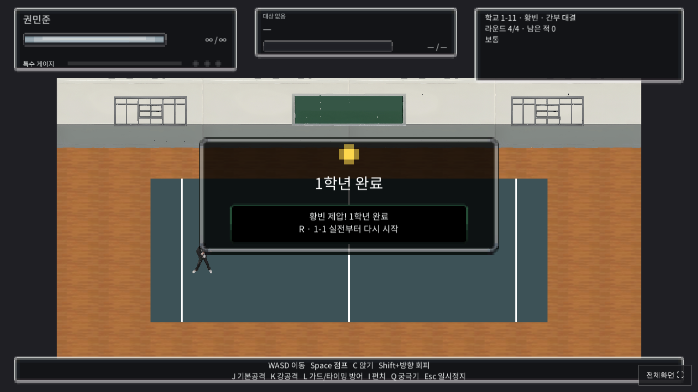

# 잔몹1 적용과 캠페인 시체 정리

제공된 네 FBX는 같은 학생 메시(24,996개 원본 정점·50,000개 삼각형), 33개 뼈, 스킨 가중치와 텍스처를 포함한다. 이전의 뼈대 없는 정적 FBX와 달리 재리깅 없이 제공 가중치를 사용했다. FBX의 누운 바인드 좌표계를 게임의 세로 축으로 정리하고, 기존 UV와 각 정점의 상위 네 영향 가중치를 정규화해 보존했다. 기본 색상은 8K에서 게임용 2K로 정리했다.

캠페인의 일반 학생 적을 이 모델로 교체했다. 튜토리얼 설명해·덩치와 간부 모델은 기존 구성을 유지한다. 기본 펀치는 왼손→오른손→3타부터 무작위 규칙을 유지하며 강공격은 제공한 Mma Kick과 Kicking을 번갈아 사용한다. 발차기는 펀치 순서를 소비하지 않는다. 걷기·준비·피격·방어는 기존 제공 모션을 새 뼈대에 연결한다.

파일별 모션과 타격 프레임은 `import.json`에 기록했다. 오른손 펀치는 원본부터 팔을 완전히 뻗는 동작이고, 왼손은 약 142도로 굽힌 원본 동작이다. 해당 자세를 똑같이 완전 신전했다고 주장하지 않는다.

모델 크기는 FBX의 표시용 컬링 경계가 아니라 실제 스킨 정점의 높이로 측정해 1.85m 기준으로 맞춘다. 골반의 모션 이동은 게임의 미터 단위로 적용하고, 발 접지 보정에는 모델 배율을 반영해 단위가 중복 적용되지 않도록 했다. 텍스처는 임포트와 빌드 전 검사에서 실제 Texture2D 로드를 확인한다.

캠페인 적은 쓰러짐이 끝나 바닥에 정착한 뒤 1.25초 후 오브젝트 전체를 제거한다. 라운드 전환이나 클리어 확인을 기다리지 않고 실행되며, 일반 적·중간 보스·마지막 보스에 같은 정책을 적용한다. 일시정지 중에는 타이머도 정지한다. 재시도가 필요한 튜토리얼 상대는 자동 제거하지 않는다.

검사 범위: 새 학생의 네 공격·걷기·준비·피격·방어 자세, 실제 AI와 피해, 사망·바닥 접촉·복구; 튜토리얼 뒤 캠페인에서 새 학생이 생성되는지; 1-5 보스, 1-6 잔몹, 1-10·1-11 보스를 실제 피해로 처치한 뒤 라운드를 넘기지 않고 기다려 시체가 제거되는지; 제거 후 1-5→1-6 전환. 후기 스테이지 검사는 별도 테스트 장면에서 실제 EncounterDirector의 해당 스테이지 생성 경로를 호출한다. 전체 캠페인을 수동으로 완주했다는 뜻은 아니다.

## 실제 실행 검증

검증 소스: `f750ce55916485488cb900227e8b10660da15eb4`. [Unity 빌드·브라우저 검사·배포 성공](https://github.com/pig556347-boop/-0-/actions/runs/38824805736).

- 새 학생 모델·모션·스킨·실제 AI·피격·사망 검사: 31,767개 통과 (`minion1.json`).
- 덩치전 및 캠페인 1-5·1-6·1-10·1-11 시체 정리·일시정지·전환 검사: 85개 통과 (`deongchi-duel.json`).
- 기존 HUD 4개 해상도 각 412개, 기존 제공 모션 2회 각 623개 및 로비·튜토리얼·음악 정지/재개 회귀 검사 통과. 런타임 오류 배열은 비어 있다 (`summary.json`).
- 소스 정적 재검토: C# 944개 파일/조건 조합, JS 문법, 공백 오류 검사 통과.

최종 클리어 뒤 제거된 화면: .

[플레이](https://pig556347-boop.github.io/-0-/?v=f750ce55)
