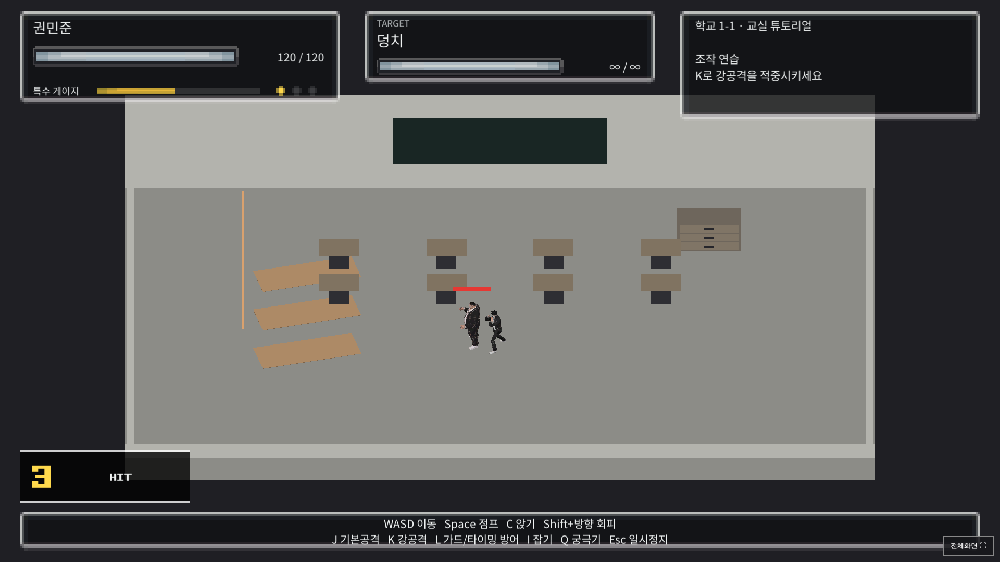
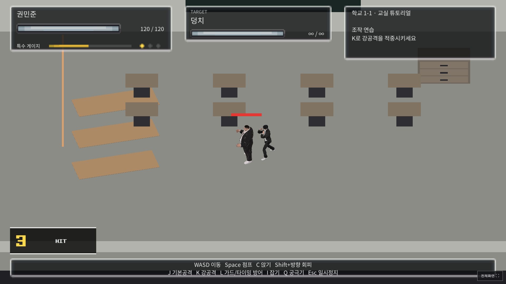

# 전투 화면 확대

직교 카메라 크기를 10.5에서 6.5로 줄여 같은 캐릭터가 화면에서 약 1.615배 크게 보이도록 조정했다. 캐릭터 메시 스케일, 콜라이더, 공격 판정과 이동 속도는 그대로다.

`CombatCameraFollow`가 플레이어 위치와 전방 0.7m를 부드럽게 따라간다. 점프 높이에 따라 카메라가 들썩이지 않도록 기준 높이는 고정했다. 맵 가장자리의 추적 위치를 제한했다. 카메라의 부모가 추적하고 자식의 로컬 위치가 피격 흔들림을 담당하여 서로 위치를 덮어쓰지 않는다.

[성공한 웹 빌드·테스트·배포](https://github.com/pig556347-boop/-0-/actions/runs/38210585038): 소스 `f46bf48355724a4e48cc7a45487ebcc7e4871df8`.

4개 해상도 × 282개 검사 통과, 실제 이동 중 확대값과 화면 내 플레이어 유지 검증 통과. 실제 콤보 및 튜토리얼 진행, 전체화면/창 크기 변경 통과. 런타임 예외 0건.

실제 Unity 실행 화면:

## 이전

## 확대 후

[게임 실행](https://pig556347-boop.github.io/-0-/)
