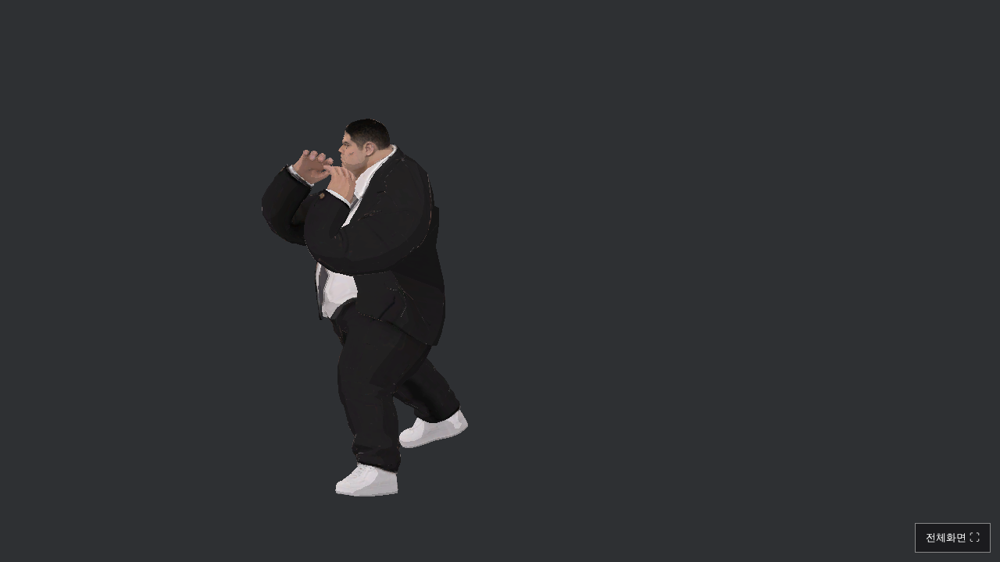
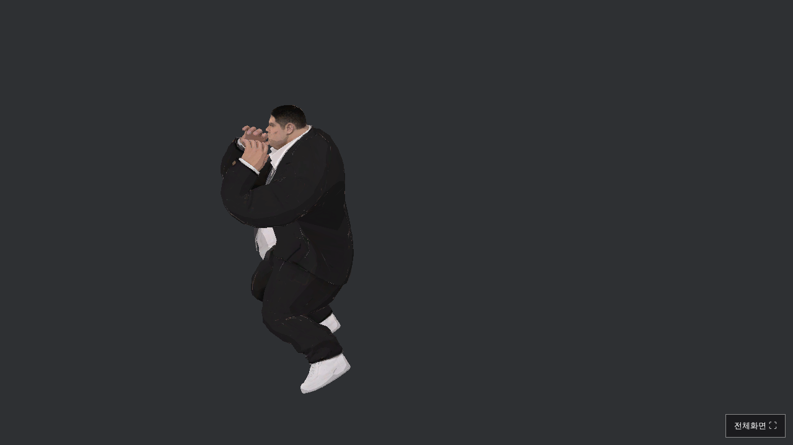
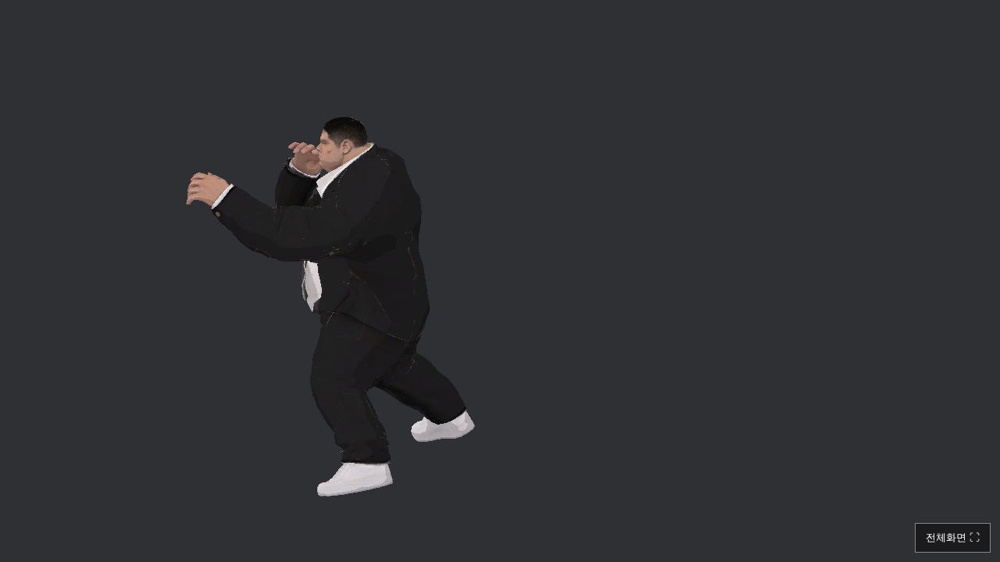
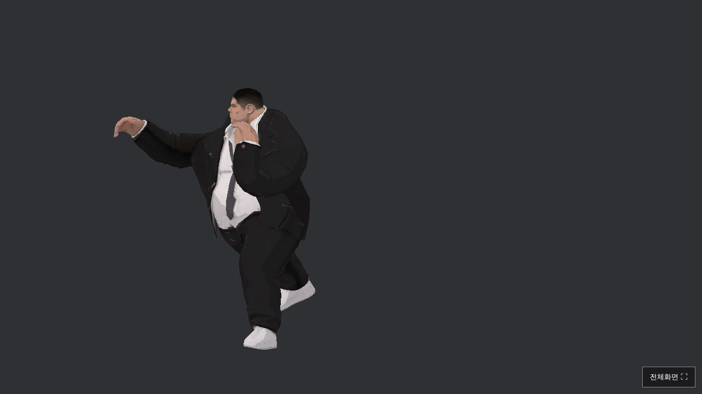
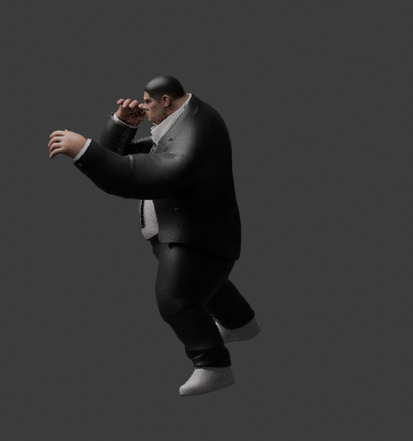
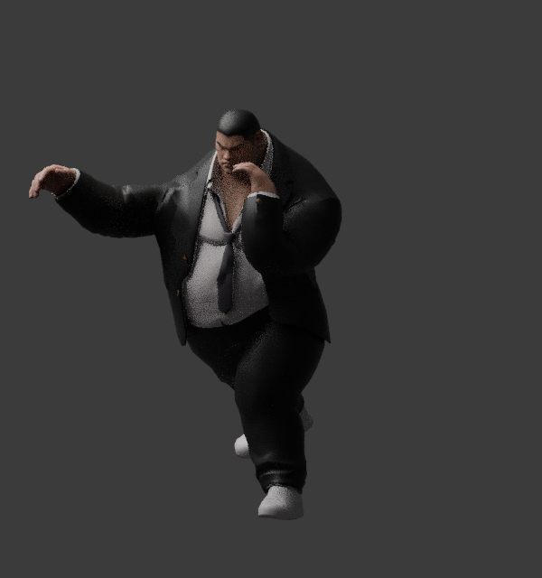
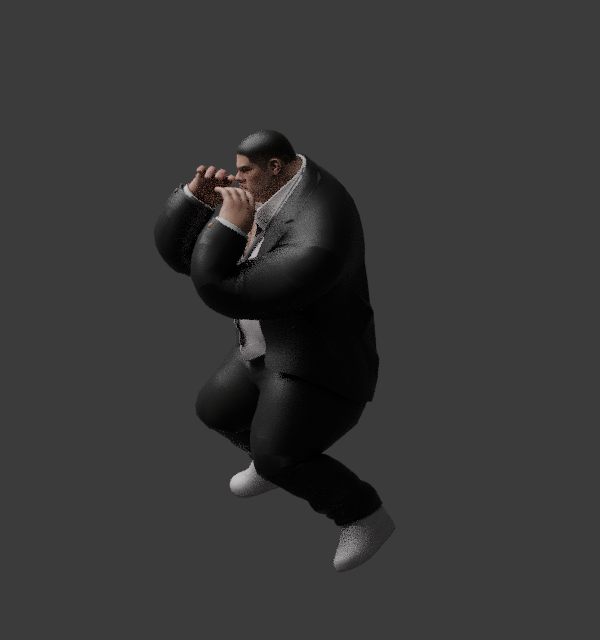

# 덩치 공격·이동 모션 수정

## 변경

- 낮은 격투 준비 자세와 얼굴 근처 가드. 덩치 체형에 맞춰 가드 폭과 앞쪽 여유를 넓힘.
- 이동 속도에 맞춘 보폭·보행 주기, 긴 접지 시간(주기의 55%), 작은 발 들기와 골반의 무게 이동.
- 이동 시작·정지 시 보폭과 가드 전환을 부드럽게 연결.
- 좌우 공격: 준비 동작 → 골반/어깨 회전 → 팔꿈치 신전과 타격 → 같은 가드로 회수. 반대 손은 얼굴 근처에 유지.
- 공격 중 양발 위치를 고정하고, 공격 쪽 발은 제자리에서 피벗. 손이 닿는 목표는 실제 팔 길이에 맞춰 계산.
- 실제 `AttackPrepared`/`StrikeStarted` 이벤트, 기존 공격 준비·회복 시간과 연결.

전투 판정·피해량·AI 이동 속도·튜토리얼 무한 HP·맵·UI는 유지했다. 덩치 궁극기의 기존 시각 동작은 유지했다.

원본 19본 모델에는 손가락 관절이 없으므로 손가락을 완전히 쥐는 주먹 형태는 이번 변경에 포함되지 않는다.

## 검사

- C# 272 파일/설정 조합 문법 검사 통과.
- Blender 좌우 공격/보행 63구간: 유한한 메시, 범위 및 지면 침범 검사 통과. 준비·좌우 타격·복귀·보행의 렌더 확인.
- Unity WebGL 4개 해상도 × 398개 검사 = 1,592개 검사 통과. 런타임 예외 0건.
- 실제 공격 이벤트의 손 전진 거리와 팔꿈치 신전 검증 통과. 양발 접지·좌우 공격 회수·이동 가드·앉기·무한 HP·기존 플레이어 콤보 및 HUD·전체화면/창 크기 변경도 통과.
- 소스: `9e5cf12cfd0cbdc0be5e280e80459aac61ed2777`.
- [빌드·테스트·배포 성공](https://github.com/pig556347-boop/-0-/actions/runs/38218110838), 총 9분 5초.
- [게임 실행](https://pig556347-boop.github.io/-0-/).

실제 Unity 자세 확인용 테스트 씬 캡처:

검사 중 발견한 C# 변수 범위 충돌과 준비 동작 위치 계산의 회전/벡터 타입 오류를 수정했다. 초광폭 환경의 앉기 검사는 모션 갱신 후 프레임 끝에서 확인하도록 수정했으며 기존 높이 감소와 지면 기준을 유지했다.

향후 실패 진단을 위해 완료된 Actions 로그의 오류를 읽기 권한으로 확인하는 진단 워크플로도 추가했다.

아래는 Blender 모델 렌더이며 Unity 실행 캡처와 구분한다.

