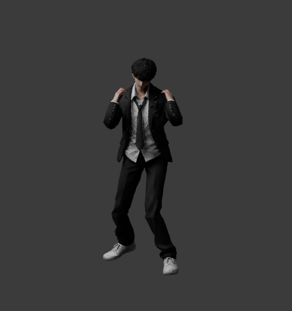
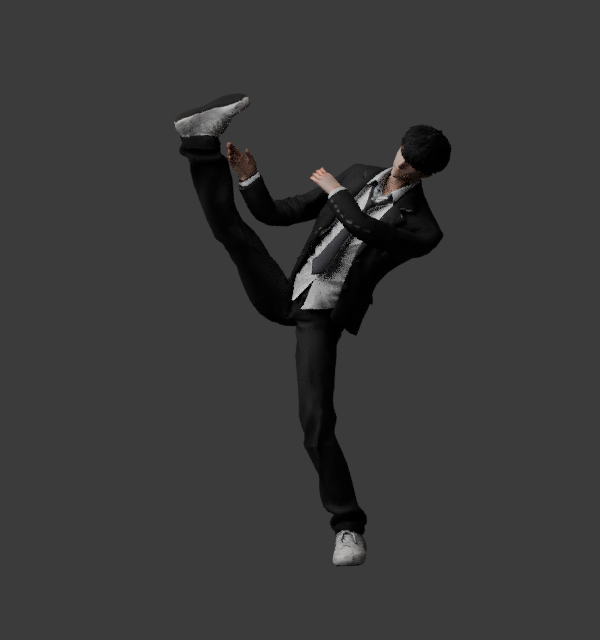
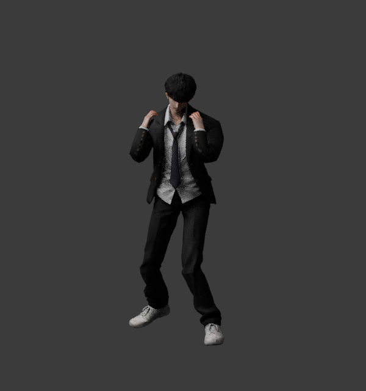

# 낮은 격투 준비 자세 및 이동 모션

참고: 사용자가 제공한 검은 교복의 격투 준비 자세. 무릎 굽힘, 상체 전경, 앞뒤로 벌린 발, 얼굴 근처 가드를 기준으로 구현했다.

## 적용 범위

- 플레이어 기본 자세: 골반 11cm 낮춤, 상체 약 11도 전경, 좌우 발 폭을 원래보다 두 배 넓히고 앞뒤로 37cm 엇갈림.
- 이동: 골반 15cm 낮춤, 가드 유지, 이동 속도에 맞춘 보폭/주기. 접지 구간 발은 월드 위치에 고정하고 다른 발은 곡선으로 들어 옮김.
- 발차기: 준비 자세에서 무게 이동과 골반 회전, 축 발 피벗, 타격과 회수 후 같은 준비 자세 복귀. 기본 3타의 오른발 뒤후리기를 유지.
- 상체: 발차기 시 균형을 잡으며 가드 손 위치가 머리 위치를 따라감. 목은 자연스러운 회전 범위 내에서 목표를 추적.
- 앉기 C, 공중 이동, 궁극기 이벤트 연결 유지.

전투 판정, 피해량, 쿨타임, 이동 속도, 콜라이더, 맵, 튜토리얼 체력 보호는 변경하지 않았다. `PrototypeHUD.CurrentEnemy`는 시선 추적을 위한 읽기 전용 접근이다.

손가락 관절이 없는 기존 19본 모델을 사용하므로 손가락을 완전히 쥐는 주먹 모델링은 별도 작업이다. 이번 변경은 팔·손목·가드 위치와 전신 동작에 적용했다.

## 검증

- C# 264 파일/설정 조합 문법 검사 통과.
- Blender 뒤후리기 21구간: 유한한 메시, 지면 침범 및 축 발 위치 검증. 최대 축 발 오차 0.9mm.
- Unity WebGL: 4개 해상도 × 282개 검사 = 1,128개 검사 통과. 실제 기본 3타와 튜토리얼 진행, 덩치 모델, 무한 HP, 전체화면/창 크기 변경 통과. 런타임 예외 0건.
- 소스 커밋: `0b6cbd4050652f24499ea761707322b834039cb9`.
- [빌드·테스트·배포 성공 실행](https://github.com/pig556347-boop/-0-/actions/runs/38207610116), 총 10분 58초.
- [게임 실행](https://pig556347-boop.github.io/-0-/).

실제 Unity 실행 캡처:

- [준비 자세](https://pig556347-boop.github.io/-0-/verification/fight-ready.png)
- [이동 자세](https://pig556347-boop.github.io/-0-/verification/fight-stride.png)
- [발차기](https://pig556347-boop.github.io/-0-/verification/fight-roundhouse.png)
- [뒤후리기](https://pig556347-boop.github.io/-0-/verification/hook-impact.png)
- [실제 교실 전투 화면](https://pig556347-boop.github.io/-0-/verification/production-hud.png)

Blender 소스 렌더(실제 Unity 실행 캡처와 구분):

