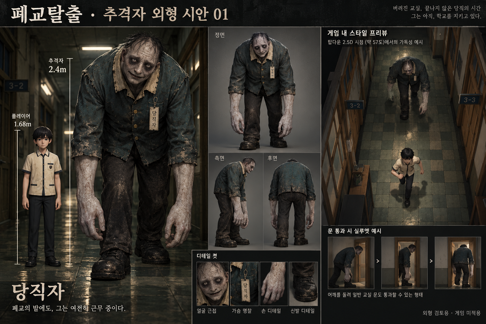

# 추격자 외형 시안 01 — 당직자

2026-10-23 사용자 요청에 따른 외형 검토용 시안. 이번 작업은 이미지와 디자인 기록이며 게임 모델, 추격 AI, 사운드, 스태미나를 구현한 결과가 아니다.

## 선택과 이유

- 선택 1: 폐교의 당직자를 모티브로 한 독자적인 인간형 추격자. 학교 공간과 연결되는 당직복·명찰로 정체성을 만들고, 큰 체격과 긴 팔로 추격의 압박감을 표현한다.
- 제작 기준 치수: 플레이어 약 1.68m, 추격자 약 2.4m, 어깨 폭 0.85~0.9m. 이미지의 연출상 크기보다 이 치수를 향후 모델과 충돌체의 기준으로 삼는다. 굽은 자세와 문턱에서 어깨를 돌리는 동작을 고려하되 실제 통과 여부는 구현 단계에서 검증한다.
- 탑다운 식별: 굽은 등·비대칭 어깨·무릎 가까이 내려오는 손·위로 들린 얼굴. 짙은 녹색 당직복에 창백한 얼굴과 손, 밝은 세로 명찰로 대비를 준다.
- 사용자 작품 언급은 추격의 긴장감과 방을 넘어 이어지는 추격에 대한 참고로 해석했다. 외형은 새로 생성했으며 기존 다른 게임의 코드·에셋·모션·설정·기획을 사용하지 않았다.

## 확보 및 추가 필요 자산

- 확보: 신규 생성 외형 시안 `References/ChaserConcept01.png` 1장. 정면·측면·후면·게임 시점 예시·문틀 통과 자세를 포함한다.
- 이번에 임시 제작한 게임 자산: 없음. 이미지의 추격 장면은 연출이며 실제 게임 화면이 아니다.
- 추가 필요: 최종 3D 메시·재질·리깅, 대기/걷기/달리기/회전/문틀 통과 애니메이션, 발소리·호흡·추격 사운드. 크기와 얼굴 가독성은 현재 게임 카메라에서 검증해야 한다.

## 검증 및 재개 지점

- 기존 전용 브랜치의 깨끗한 작업 트리를 확인하고 이미지를 생성·보존했다. 게임 코드와 공개 웹 버전 0.6은 변경하지 않았다.
- 이미지에 외형 검토용·게임 미적용 표기를 넣었다. 실행 파일 변경이 없어 Unity/브라우저 게임 검사를 새로 수행하지 않았다.
- 다음 작업: 외형 방향의 수정 요청을 반영하거나 원본 게임에 맞는 모델과 애니메이션을 제작한다. 이후 방 이동을 일정 부분 이어가는 추격, 스태미나, 사운드를 단계별로 구현·검증한다. 구체적인 추격 규칙과 수치는 아직 결정하지 않았다.
