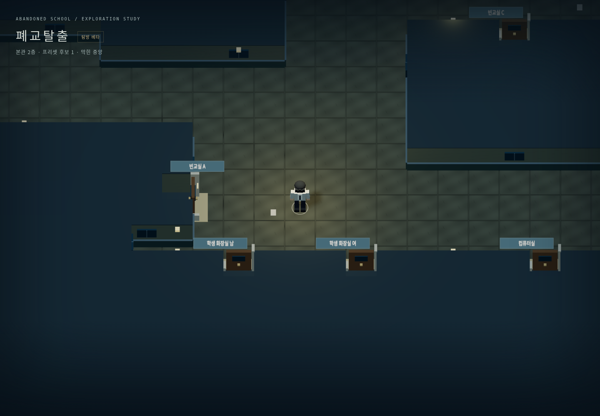
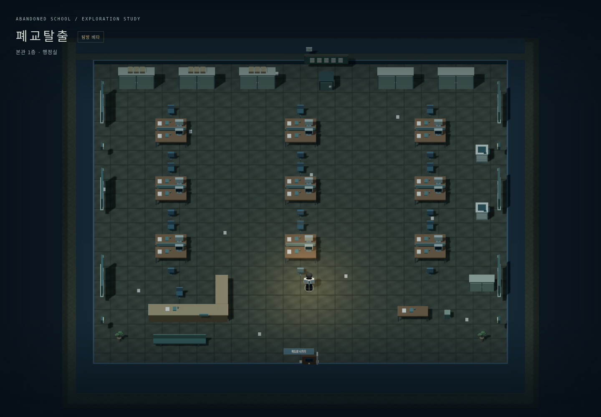
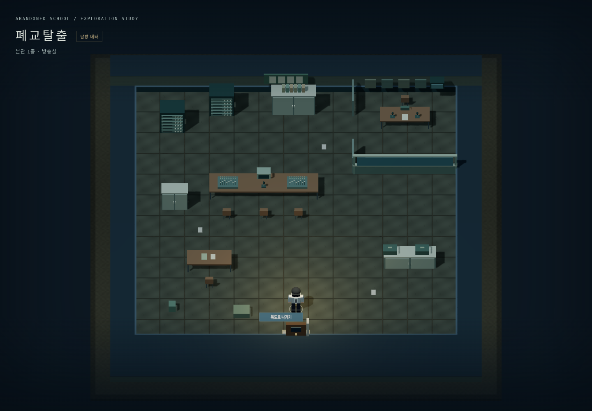
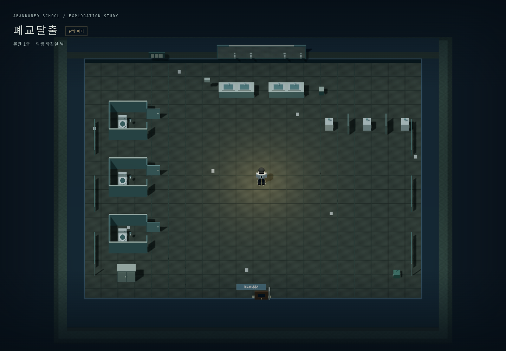
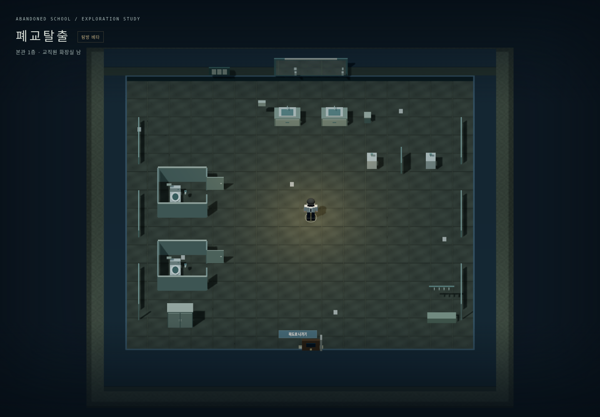
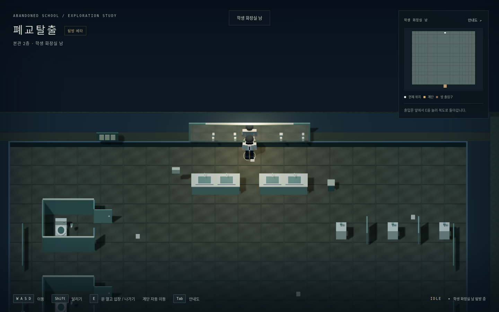
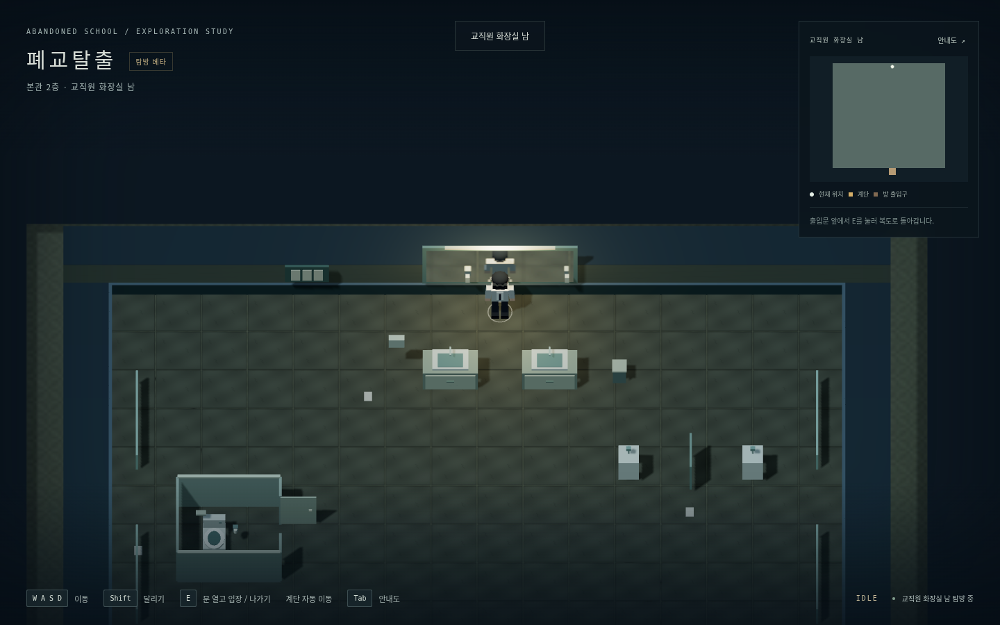

# 복도 수정·방송실·화장실

이번 사용자 요청은 손그림형 복도, 행정실 좌석 증설, 1층 도서실의 빈교실 전환, 방송실과 구분되는 학생/교직원 화장실 및 큰 거울입니다. 전용 프로젝트와 브랜치에만 반영합니다.

| 요청 | 적용 |
|---|---|
| 손그림 복도 | 2층 빈교실 A를 왼쪽으로 물리고 동쪽 문으로 변경. 그 오른쪽 세로 구간에서 남녀 화장실 앞 가로 구간으로 꺾이는 폭4셀(5m) 복도. 기존1셀 병목 제거 |
| 행정실 | 기존26×24셀에서2인 책상 섬9개(3열×3행), 총18업무석. 접수대·문서장·금고·복사기 유지 |
| 1층 도서실 | 기존 문/외곽 위치의 `빈교실 3`으로 전환. 칠판·책걸상·큰4×2사물함을 가진 교실 모듈. 도서실은2층에1개만 유지 |
| 방송실 | 1층 기존 문에15×15셀 독립 실내. 교실18×18셀의 가용 바닥 면적65%. 작은 방송 조정실과 같은 맵으로 연결된 방송 부스 |
| 화장실 | 층마다 학생 남/여와 교직원 남/여를 각각 독립 맵으로 제작.3층×4개=총12개 |
| 큰 거울 | 학생6.4m·교직원4m 폭, 높이1.55m. 실제 현재 방과 캐릭터를 반사. 세면대 중앙에 접근 통로를 두어 거울 가까이 설 수 있음 |

북쪽을 기준으로2층 전체 좌표의 세로 복도는x30–33/y7–14, 가로 복도는x30–43/y7–10입니다. 빈교실 A문(29,9)은 동쪽을 향하고, 남녀 화장실 문 앞은(31,7)/(35,7)입니다. 후보1의 중앙 벽/다른 방/계단과 기존 서관·별관 통로는 유지했습니다.

## 학생·교직원 및 남녀 차이

| 구분 | 공간 | 세면대 | 개인 칸 | 남자 소변기 | 구별 요소 |
|---|---|---|---|---|---|
| 학생 남 |22×20셀 |4 |3 |3 |긴 공용 세면대, 청소함/대걸레, 학생 위생 게시물 |
| 학생 여 |22×20셀 |4 |5 |없음 |칸 수 증가, 칸별 위생함 |
| 교직원 남 |18×18셀 |2 |2 |2 |개별 하부 수납 세면대, 의복장·옷걸이·벤치 |
| 교직원 여 |18×18셀 |2 |3 |없음 |교직원 설비와 수납, 칸별 위생함 |

각 개인 칸의 칸막이·변기·문은 충돌을 가지며, 칸문은 보행 가능한 정적 열린 패널로 표현합니다. 외부 방문은 기본 닫힘/E입퇴실을 유지합니다. 개인 칸을 별도 맵으로 나누거나 새 상호작용을 추가하지 않습니다.

## 방송실 근거

원 시안서는 방송실 위치/역할을 제시하며, 읽은 맵 백업은 기존 방송실 이미지가 폐기되었고 학교 방송실답게 재설계해야 한다고 명시합니다. 해당 이미지를 복제하지 않고 작은 학교 PA 조정실을 새로 정했습니다. 메인 콘솔·2믹서·3마이크·2장비랙·학교 방송 TV·테이프/CD/서류 보관과 작은 연결 부스가 있습니다. 현대 전문 스튜디오나 조사/드랍/열쇠/괴이 기능을 추가하지 않았습니다.

## 반사와 에셋

웹은 직교 카메라에 맞는 평면 반사 카메라·512×512 렌더 타깃·거울면 클리핑과 투영 샘플링을 사용합니다. 캐릭터 모델을 숨겼다 복원하며 실제 반사 텍스처의 픽셀 차이를 확인합니다. 조명은 비교 중 유지합니다. 음악실 외 다른 맵의 루트는 계속 비활성 상태라 반사에 나타나지 않습니다.

Unity에는 독자 `PlanarMirror.cs`와 `Resources/PlanarMirror.shader`를 추가했습니다. C# 컴파일·셰이더 임포트와 실제 Unity Play/화면 검증은 구분하여 [VALIDATION.md](VALIDATION.md)에 기록합니다. 거울은 물리적으로 수직이므로 멀리 서면 바닥이나 세면대가 보이고, 가까이 서면 인물 반사가 보입니다.

방송 장비·변기·칸막이·세면대·소품·거울 프레임은 새 임시 기하 모듈입니다. 최종 학교 설비 모델과 낡은 표면 텍스처는 [에셋 목록](ASSETS.md)의 교체 대상입니다. 코드 생성기는 `Tools/facility_rooms.py`, 반사 모듈은 `Web/mirror.mjs`입니다.

## 실제 구현 화면

손그림을 반영한 실제복도입니다.

| 행정실18석 | 새방송실 |
|---|---|
|  |  |

| 학생화장실 | 교직원화장실 |
|---|---|
|  |  |

[1층빈교실3](Evidence/facilities-overview-converted-classroom.png). 실내전체사진은검토용QA카메라로찍었으며일반플레이카메라는유지합니다. 가까이선캐릭터의거울반사화면은최신검증기록에별도저장합니다.

가까이 선 캐릭터의 실제 반사입니다.

| 학생 화장실 | 교직원 화장실 |
|---|---|
|  |  |
