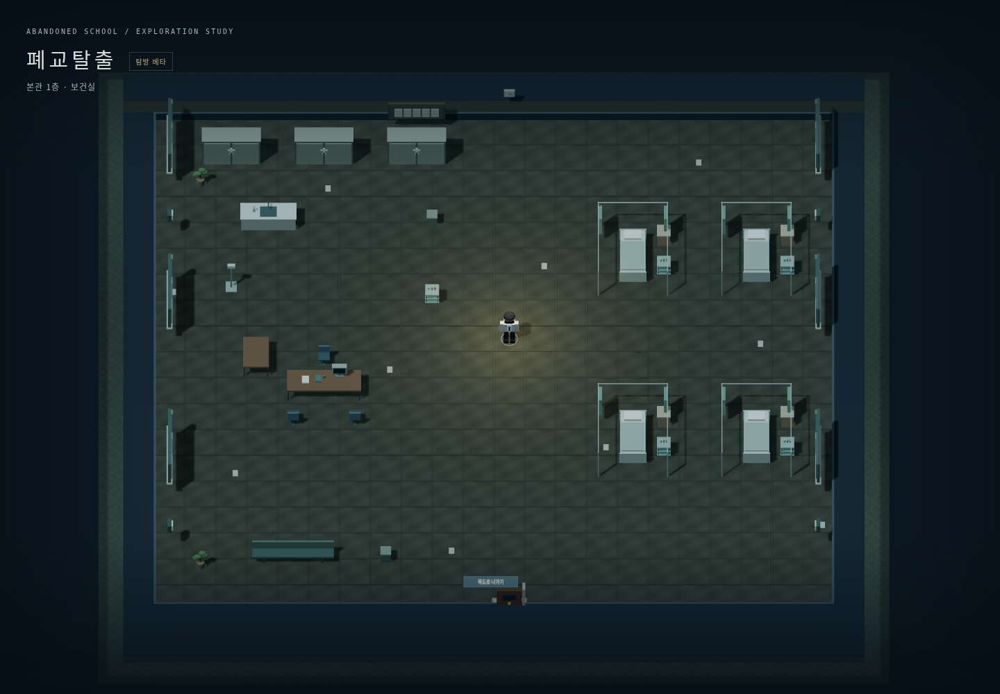
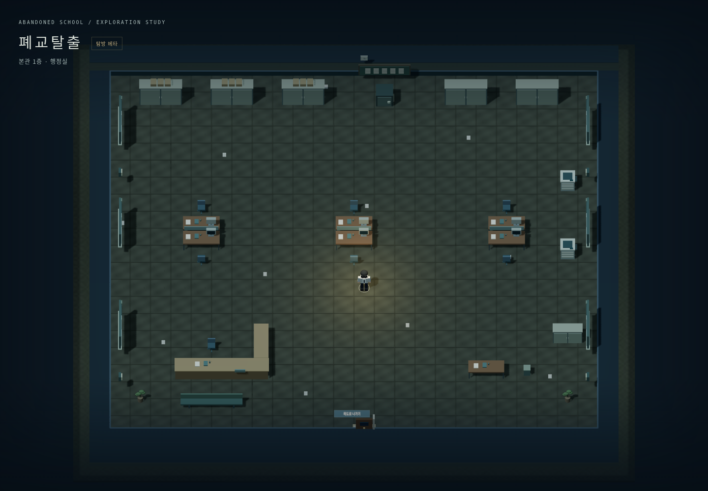
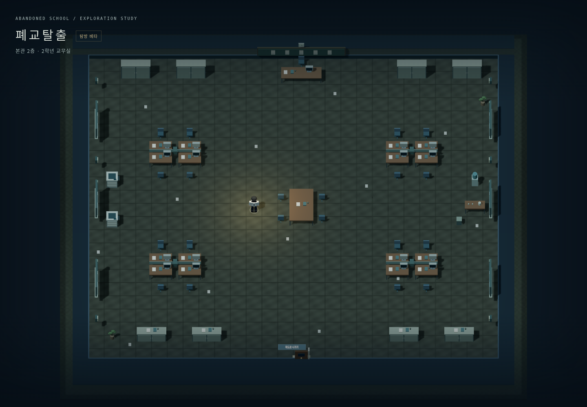
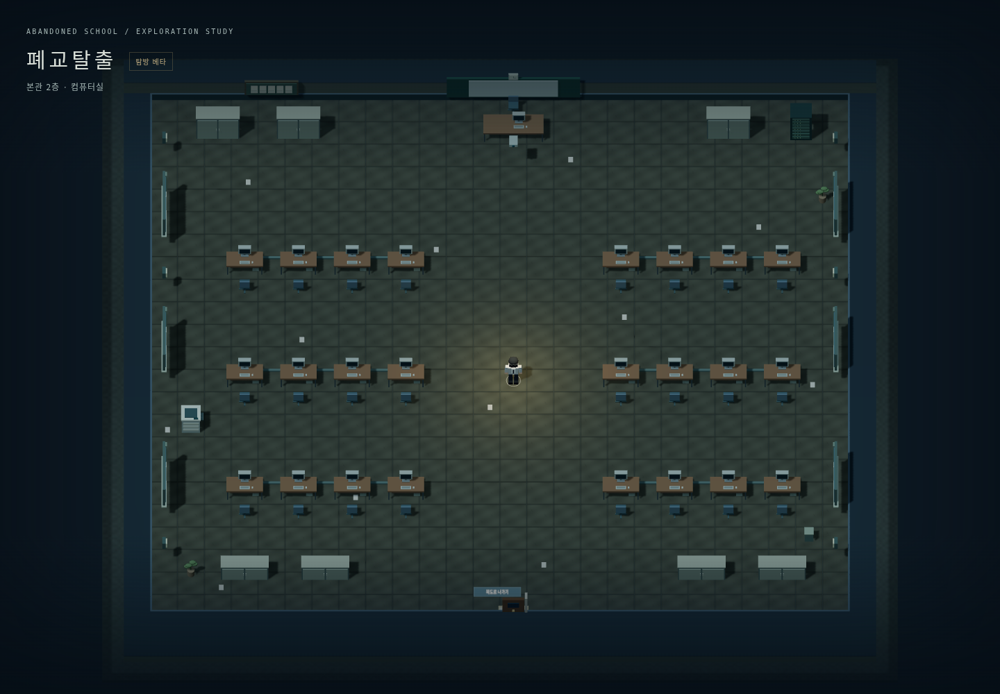

# 보건실·행정실·교무실·컴퓨터실

사용자가 4종 공간의 이미지 시안 01을 확인한 뒤 “일단 구상한대로 추가해”라고 요청하여 내부 제작에 반영했습니다. [시안 원본](References/SupportRoomsConcept.png)은 방 배치 참고자료이며 게임 텍스처로 사용하지 않습니다. 새 이미지 DOCX를 읽었다는 의미도 아닙니다.

| 방 | 연결 위치 | 맵 크기 | 배치 |
|---|---|---|---|
| 보건실 | 본관 1층, 기존 양호실 문 | 24×22셀 | 우측 커튼 병상 4개, 좌측 진료·약품·싱크, 입구 대기석 |
| 행정실 | 본관 1층 행정실 문 | 26×24셀 | L자 접수 창구, 중앙 9개 업무 섬(18석), 후면 서류장, 복사기와 금고 |
| 2학년 교무실 | 본관 2층 교무실 문 | 28×26셀 | 4개 교사 책상 섬, 중앙 회의·자료 테이블, 뒤쪽 부장석, 프린터·차 공간 |
| 3학년 교무실 | 본관 3층 교무실 문 | 28×26셀 | 같은 구성의 독립 인스턴스. 2층 교무실과 공유하지 않음 |
| 컴퓨터실 | 본관 2층 컴퓨터실 문 | 28×26셀 | 좌우 3행의 학생용 컴퓨터 24석, 중앙 통로, 전면 교사석·스크린, 네트워크 랙 |

한 셀은 1.25m입니다. 큰 탐방 맵 안에 실제 크기의 책상·침대·장비를 배치하고 가구군 사이 여유를 둡니다. 보건실 표기는 사용자의 최신 명칭으로 변경했으며 원래 복도와 문 위치는 유지했습니다. 각 공간은 남쪽 중앙 문으로 들어오고 같은 문 앞 E로 원래 층에 복귀합니다.

기본 문 닫힘, E키로 문을 연 뒤 독립 공간 이동, 입장 전 내부 미표시, 현재 방만 렌더링/충돌/안내도 활성화가 모두 적용됩니다. 계단은 기존 자동 이동입니다. 소품은 탐방용 정적 표현이며 치료·서류 처리·PC 조작·아이템·숨기·전투 기능을 추가하지 않습니다.

모듈은 새로 작성한 `Tools/support_rooms.py`에서 생성하며 Unity와 웹이 같은 `SchoolMap.json`을 읽습니다. 병상·커튼·의료 장비·서류함·컴퓨터·네트워크 장비는 임시 기하 모델이며 최종 교체 목록은 [ASSETS.md](ASSETS.md), 최신 실행 결과는 [VALIDATION.md](VALIDATION.md)를 참조하세요.

## 실제 웹 실행 화면

아래는 원본 시안 이미지가 아니라 실제 구현의 전체 배치입니다. 공간 검토를 위해 QA카메라만 멀리 두고 찍었으며 일반 플레이의 추적카메라와 인물/가구 비율은 유지합니다.

| 보건실 | 행정실 |
|---|---|
|  |  |

| 교무실 | 컴퓨터실 |
|---|---|
|  |  |

최신사용자요청으로행정실을기존6업무석에서18석으로늘렸습니다. 기존시안이미지는최초배치참고이며현재실제배치는[FACILITIES.md](FACILITIES.md)가기준입니다.
